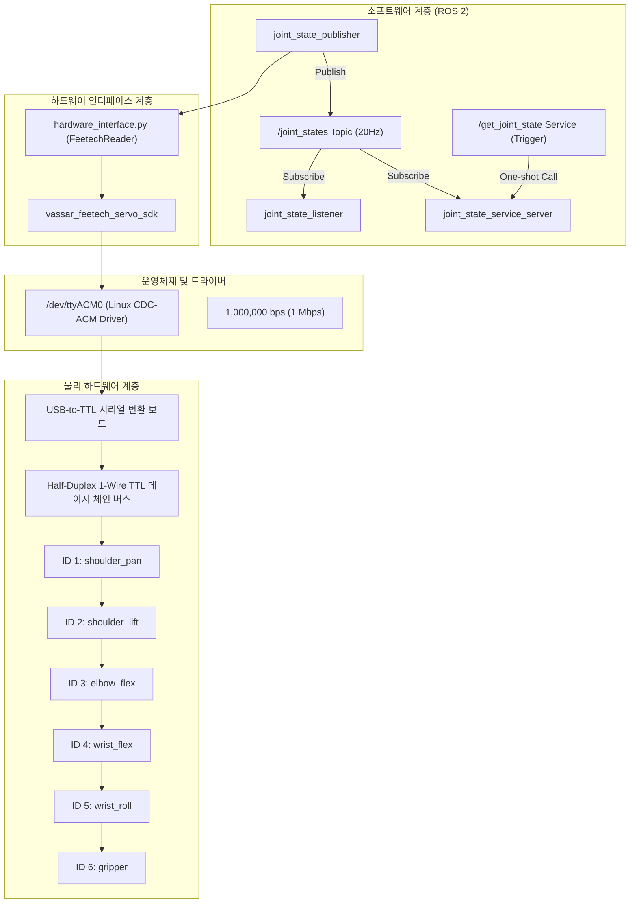

# [3주차] 실습 하드웨어 시스템 및 장치 가이드 (Hardware Guide)

본 문서는 **[3주차] ROS 2 Basic 2 실습**에 사용되는 로봇 하드웨어(6축 로봇 암, 스마트 서보 모터, 제어 보드, 시리얼 통신, NVIDIA Jetson)의 동작 원리와 배경지식을 상세히 정리한 하드웨어 매뉴얼입니다.

---

## 📌 목차
1. [하드웨어 시스템 개요](#1-하드웨어-시스템-개요)
2. [전체 시스템 아키텍처 및 계층 구조](#2-전체-시스템-아키텍처-및-계층-구조)
3. [NVIDIA Jetson 임베디드 제어 플랫폼](#3-nvidia-jetson-임베디드-제어-플랫폼)
4. [6축 로봇 암 (PhysicAI Arm) 기구학 구조](#4-6축-로봇-암-physicai-arm-기구학-구조)
5. [스마트 버스 서보 모터 (Feetech STS3215)](#5-스마트-버스-서보-모터-feetech-sts3215)
6. [시리얼 통신 버스 및 /dev/ttyACM0](#6-시리얼-통신-버스-및-devttyacm0)
7. [엔지니어링 단위 변환 (Tick ➔ Radian) 원리](#7-엔지니어링-단위-변환-tick--radian-원리)
8. [하드웨어 실전 트러블슈팅 및 안전 수칙](#8-하드웨어-실전-트러블슈팅-및-안전-수칙)

---

## 1. 하드웨어 시스템 개요

현대 로봇 시스템은 고성능 컴퓨터 한 대가 모든 모터를 직접 전선으로 제어하지 않고, **분산 임베디드 제어(Distributed Embedded Control)** 방식을 사용합니다.

본 실습에서는 로봇 공학의 표준적인 **HAL(Hardware Abstraction Layer, 하드웨어 추상화 계층)**을 다룹니다.
- 실제 로봇 팔의 모터로부터 물리량(엔코더 펄스)을 고속 시리얼 버스로 읽어옵니다.
- 이를 ROS 2의 표준 규격(`sensor_msgs/msg/JointState`)으로 변환하여 Topic 및 Service 통신망에 배포합니다.
- 상위 레벨(모션 플래닝, 원격 제어, AI 모델)은 하드웨어의 복잡한 물리 배선을 몰라도 표준 인터페이스로 로봇을 제어할 수 있게 됩니다.

---

## 2. 전체 시스템 아키텍처 및 계층 구조



---

## 3. NVIDIA Jetson 임베디드 제어 플랫폼

### 3-1. 왜 일반 데스크톱이 아닌 Jetson을 사용하는가?
- **모빌리티 및 저전력**: 자율 로봇(AGV, 휴머노이드 등)은 배터리로 기동해야 하므로 무겁고 전력을 많이 소모하는 데스크톱 PC를 탑재할 수 없습니다. Jetson은 손바닥 크기이면서도 저전력(10~25W)으로 Ubuntu Linux와 ROS 2를 구동합니다.
- **풍부한 I/O 포트**: 시리얼(UART), CAN, I2C, SPI, GPIO 등 산업용/로봇용 센서 및 구동기와의 인터페이스를 보드 자체에서 완벽하게 지원합니다.

### 3-2. 실습실 Jetson 환경 구조
- **계정 체계**: 요일별 분반(`mon`, `tue`, `wen`, 초기 비밀번호: `1234`)
- **ROS 2 설치 위치 (`~/ros2_base`)**:
  - 일반 PC(WSL/우분투)는 `apt install`을 통해 시스템 경로(`/opt/ros/humble`)에 설치됩니다.
  - 실습실의 Jetson은 임베디드 환경 최적화를 위해 사용자 홈 디렉터리 하위 `~/ros2_base/install`에 **소스 빌드(Source Build)**되어 있습니다.
  - 따라서 매 터미널마다 `source ~/ros2_base/install/setup.bash` 실행이 필수적입니다.

### 3-3. `fix_setup.sh`의 기술적 배경
- **문제 원인**: Jetson 이미지 생성 과정에서 빌드 디렉터리 경로(`soda/ros_ws`)가 `setup.bash` 내부 prefix 변수에 하드코딩되어 환경 로드 시 에러 발생.
- **해결 원리**: `sed` 명령어로 잘못된 경로 설정 구문을 주석(`#`) 처리하여 현재 로그인 계정의 정상 경로를 참조하도록 패치합니다.

---

## 4. 6축 로봇 암 (PhysicAI Arm) 기구학 구조

본 실습에 사용되는 로봇 팔은 사람의 팔 구조를 본뜬 **6자유도(Degrees of Freedom, DOF)** 수직 다관절 매니퓰레이터입니다.

| 관절 이름 (`joint_names`) | 서보 ID | 축 분류 | 물리적 운동 및 역할 |
|---|:---:|:---:|---|
| **`shoulder_pan`** | 1 | Base Yaw | 로봇 베이스 몸통 좌우 회전 (수평 선회) |
| **`shoulder_lift`** | 2 | Shoulder Pitch | 어깨 관절. 팔 전체를 앞/뒤 및 위/아래로 들어 올림 |
| **`elbow_flex`** | 3 | Elbow Pitch | 팔꿈치 관절. 상완과 하완 사이의 굽힘/폄 동작 |
| **`wrist_flex`** | 4 | Wrist Pitch | 손목 꺾임 관절. 그리퍼의 피치(상하 끄덕임) 각도 조절 |
| **`wrist_roll`** | 5 | Wrist Roll | 손목 회전 관절. 엔드이펙터를 축 중심으로 비틀어 회전 |
| **`gripper`** | 6 | End-Effector | 집게 관절. 물체를 파지(Grasp)하거나 놓는 개폐 동작 |

### 관절 설정 파일 분석 (`config/joints.yaml`)
```yaml
joint_names:
  - shoulder_pan
  - shoulder_lift
  - elbow_flex
  - wrist_flex
  - wrist_roll
  - gripper

# 모터 회전 방향 정의 (1: 정방향, -1: 역방향)
sign:
  shoulder_pan: 1
  shoulder_lift: 1
  elbow_flex: 1
  wrist_flex: 1
  wrist_roll: 1
  gripper: 1

# 물리적 조립 오차를 보정하기 위한 영점 오프셋 (단위: rad)
zero_offset_rad:
  shoulder_pan: 0.0
  shoulder_lift: 0.0
  elbow_flex: 0.0
  wrist_flex: 0.0
  wrist_roll: 0.0
  gripper: 0.0

device: /dev/ttyACM0
baudrate: 1000000   # 1 Mbps
publish_hz: 20.0    # 20 Hz
```

---

## 5. 스마트 버스 서보 모터 (Feetech STS3215)

로봇 암의 각 관절은 일반 RC 서보가 아닌 **스마트 시리얼 버스 액추에이터(Feetech STS3215)**를 채택하고 있습니다.

### 5-1. 일반 RC 서보 vs 스마트 버스 서보 비교

| 비교 항목 | 일반 RC PWM 서보 | 스마트 시리얼 버스 서보 (**STS3215**) |
|---|---|---|
| **신호 방식** | 50Hz 아날로그 PWM 펄스 (1~2ms) | 패킷 기반 디지털 UART 시리얼 통신 |
| **통신 방향** | **단방향** (지령만 전송, 상태 확인 불가) | **양방향 (Full Telemetry Feedback)** |
| **피드백 정보** | 없음 | **현재 각도, 속도, 부하(토크), 전압, 온도** 실시간 수신 |
| **배선 구조** | 모터마다 개별 신호선 필요 (6모터 = 18선) | **데이지 체인 (Daisy-Chain)** 직렬 공유 (3선) |
| **각도 센서** | 저가형 접촉식 가변저항 (마모/수명 한계) | **12-bit 자기식 비접촉 절대 엔코더** |
| **제어 단위** | 타이머 펄스 폭 | 모터별 고유 **ID (1~254)** 및 레지스터 번지 |

### 5-2. 데이지 체인 (Daisy-Chain) 버스 토폴로지
모터 몸체마다 양쪽에 커넥터 포트가 있어, `제어보드 ➔ 모터1 ➔ 모터2 ➔ ... ➔ 모터6` 형태로 하나의 버스 선로에 꼬리를 물듯 연결됩니다. 로봇 관절이 아무리 많아져도 제어기에서 나가는 케이블은 단 1개(GND, VCC, Data)로 유지되어 배선 트러블을 획기적으로 줄여줍니다.

---

## 6. 시리얼 통신 버스 및 `/dev/ttyACM0`

### 6-1. 1,000,000 bps (1 Mbps) 고속 보레이트의 필요성
- 일반적인 아두이노 시리얼 통신은 9,600 또는 115,200 bps를 사용합니다.
- 본 실습은 **20Hz (초당 20회, 즉 50ms마다 1회)** 주기로 6개 모터의 위치를 모두 읽어와야 합니다.
- 매 50ms마다:
  1. Jetson ➔ 모터 질의 패킷 전송 (Request Frame)
  2. 모터 ➔ Jetson 응답 패킷 수신 (Response Frame, 6축 분량)
  3. 데이터 파싱 및 유효성 검사
- 115,200 bps에서는 통신 지연(Latency)으로 인해 20Hz 주기를 맞추지 못하고 데이터 지연(Jitter)이 발생합니다. 따라서 **1 Mbps(1,000,000 bps)**의 고속 통신을 사용합니다.

### 6-2. `/dev/ttyACM0` (Linux CDC-ACM Driver)
- Jetson의 USB 포트에 연결된 USB-to-TTL 변환 칩이 리눅스 커널에 의해 `CDC-ACM(Communication Device Class)` 표준 가상 직렬 장치로 인식됩니다.
- **시리얼 포트의 독점(Exclusive) 잠금 속성**:
  - 리눅스 시리얼 포트는 **하나의 프로세스만 독점하여 Open**할 수 있습니다.
  - `joint_monitor.launch.py`와 `bringup.launch.py`를 동시에 실행하면, 두 번째 실행된 노드가 `/dev/ttyACM0`을 열지 못해 충돌(`Resource temporarily unavailable` 또는 `Permission denied`)이 발생합니다.

---

## 7. 엔지니어링 단위 변환 (Tick ➔ Radian) 원리

서보 모터 내부 MCU는 각도를 물리 단위가 아닌 **엔코더 틱(Tick) 정수값**으로 관리합니다. 이를 ROS 2의 표준 각도 단위인 **라디안(Radian)**으로 변환하는 과정이 하드웨어 인터페이스의 핵심입니다.

### 7-1. 12-bit 자기식 엔코더 스펙
- **분해능 (Ticks per Revolution)**: $2^{12} = 4096 \text{ ticks}$ (한 바퀴 $360^\circ$)
- **분해 각도**: $360^\circ / 4096 \approx 0.08789^\circ$ 단위로 미세 각도 측정 가능
- **중앙값 (Center Tick)**: $2048 \text{ tick}$ ($0^\circ$ 기준 중립 위치)

### 7-2. 수학적 변환 공식
```text
               (Tick - 2048)
각도(rad) =  ────────────────  ×  2π  ×  sign  +  zero_offset_rad
                   4096
```

### 7-3. 소스코드 매핑 ([`hardware_interface.py`](file:///d:/WorkSpace/ROS_PNU/week3/week03_ros2_jetson/week03_ros2_jetson/hardware_interface.py))
```python
def _tick_to_rad(self, name: str, tick: int) -> float:
    config = self._config
    shifted = (
        (tick - config.center_tick)       # 2048 기준 편차 계산
        * (2.0 * math.pi)                 # 2π (360도) 곱셈
        / config.ticks_per_rev            # 4096 분해능으로 나눔
    )
    return shifted * config.sign[name] + config.zero_offset_rad[name]
```

---

## 8. 하드웨어 실전 트러블슈팅 및 안전 수칙

### 8-1. 자주 발생하는 하드웨어 오류 및 해결책

| 증상 | 원인 | 즉각 조치 방법 |
|---|---|---|
| `ls -l /dev/ttyACM0` 결과 없음 | USB 케이블 미연결 또는 접촉 불량 | 로봇 암 USB 케이블을 Jetson의 다른 USB 포트에 재연결 |
| `Permission denied: /dev/ttyACM0` | 시리얼 포트 읽기/쓰기 권한 부재 | 터미널에서 `sudo chmod 666 /dev/ttyACM0` 실행 |
| `servo id X의 응답이 없습니다` | 특정 번호 모터 전원/신호선 단선 | 데이지 체인 케이블이 완전히 체결되었는지 확인 |
| `Resource busy` 에러 발생 | 이전 노드가 포트를 쥐고 있음 | `ps aux \| grep joint` 확인 후 기존 프로세스 `kill` 종료 |
| 모터 각도 출력이 멈춤 | 서보 모터 과부하 보호(Overload Lock) | 로봇 암의 관절을 수동으로 무리하게 꺾지 말고 전원 재인가 |

### 8-2. 안전 수칙 및 실습 후 정리 매뉴얼
1. **서보 모터 토크 주의**:
   - 모터 구동 중 손가락이 관절 틈에 끼이지 않도록 주의합니다.
   - 전원이 켜진 상태에서 관절을 강제로 비틀면 서보 기어가 파손(Stripped Gear)될 수 있습니다.
2. **실습 종료 시 기자재 정리 품목 (조별 감점 방지)**:
   - LAN 케이블 2개
   - 파워 케이블 2개 (어댑터 포함)
   - HDMI 케이블 1개
   - USB to Ethernet 어댑터 1개
   - 모니터 파워케이블 1개
   - *모든 케이블은 원래 비닐에 넣어 박스에 원상 복구합니다.*
